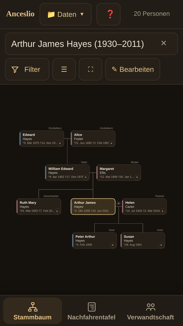
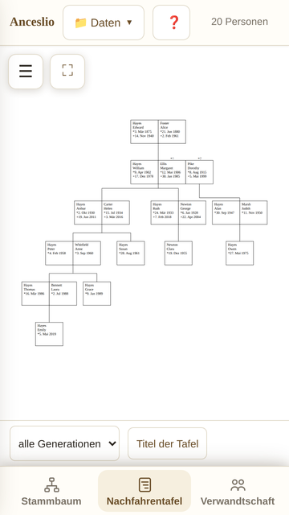
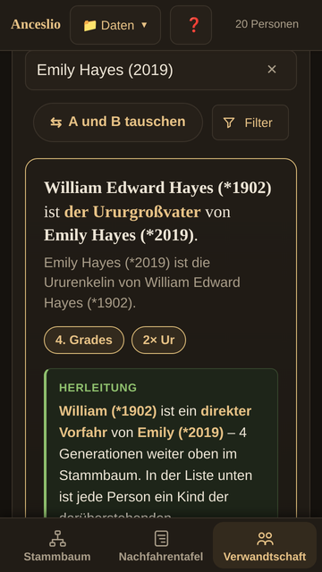
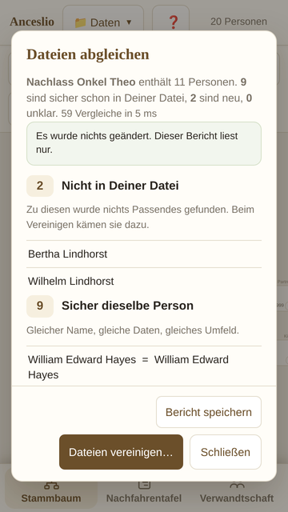

# Anceslio

**Der Stammbaum auf dem Handy — zum Nachsehen, Zeigen und Ergänzen. Ohne Konto, ohne Internet, ohne Werbung.**

[Im Browser ausprobieren](https://anceslioapp.github.io/anceslioapp/) · [Im Play Store](https://play.google.com/store/apps/details?id=app.anceslio.family)

Wer in der Familie forscht, hat die Daten meist auf dem Rechner und steht beim Familientreffen ohne sie da. Anceslio öffnet die GEDCOM-Datei — das übliche Austauschformat der Familienforschung, Endung `.ged` — und zeigt sie so, wie man sie unterwegs braucht. Die Seite oben ist dieselbe Anwendung wie die App, nur im Browser: ohne Installation, mit Beispielfamilie zum Ausprobieren.

  
  
  
  

## Was sie kann

**Stammbaum.** Eine Person in der Mitte, darum Eltern, Geschwister, Partner und Kinder; auf Wunsch weitere Generationen nach oben und unten, dazu Neffen, Nichten, Onkel und Tanten. Mehrere Ehen sind vorgesehen.

**Nachfahrentafel.** Eine Person mit allem, was aus ihr geworden ist, in der Form gedruckter Familienbücher. Als PDF in A4, A3 oder A2, außerdem als SVG und PNG. Zweige lassen sich ausblenden, Zeilen von Hand überschreiben.

**Verwandtschaft.** Zwei Personen auswählen, und es steht da: Cousine zweiten Grades, Großtante, Urgroßonkel — mit gemeinsamem Vorfahren und dem Weg über die Generationen.

**Aufräumen.** Dubletten finden (auch über Schreibvarianten wie Müller und Mueller), die Datei nach fünfundzwanzig Regeln prüfen, und eine zweite GEDCOM-Datei mit der eigenen abgleichen: wer schon da ist, wer neu ist, wo die andere Datei etwas weiß, das der eigenen fehlt. Geändert wird nur, was bestätigt wird; die letzten zehn Schritte lassen sich zurücknehmen.

**Notizen und Quellen.** Zu jeder Person lassen sich Notizen und Quellen festhalten, gespeichert als `NOTE` und `SOUR` — jedes große Programm liest sie mit. Quellensätze, auf die mehrere Personen verweisen, werden mit ihrem Titel angezeigt, aber nicht verändert.

**GEDCOM rein wie raus.** Gelesen wird GEDCOM 5.5.1, geschrieben ebenso, in UTF-8. Was die App selbst nicht anzeigt — etwa Bildverweise oder Quellen an Ereignissen — steht nach dem Export wieder an seiner Stelle. Dateien aus älteren Programmen werden auch dann richtig gelesen, wenn sie nicht UTF-8 sind: ANSEL und Windows-1252 werden erkannt.

## Was sie nicht kann

Sie ist kein Ersatz für ein großes Ahnenprogramm. Sie gleicht nichts zwischen Geräten ab, durchsucht keine Archive im Netz und verwaltet keine Bilder und Dokumente — was in der Datei dazu steht, bleibt erhalten, wird aber nicht angezeigt. Der Weg zwischen zwei Geräten führt über die `.ged`-Datei.

## Wo die Daten liegen

Auf dem Gerät, sonst nirgends. Die App fordert keine Berechtigung an, hat keinen Serverteil, keine Werbung und keine Nachverfolgung.

Für die Browser-Fassung heißt das: Die Daten liegen im Speicher dieses einen Browsers. Wer „Websitedaten löschen" anklickt, ist die Arbeit los, und was am Rechner eingegeben wurde, weiß das Handy nicht. Deshalb nach größeren Änderungen sichern: **Daten › Jetzt sichern** legt mit einem Tipp eine `.ged`-Datei ab. Die App zählt mit, was noch nicht gesichert ist, und erinnert daran.

## Rückmeldungen

Gern über [Issues](../../issues) — besonders über Dateien, die nicht sauber eingelesen werden. Echte Exporte aus alten Programmen sind die beste Prüfung.

## Lizenz und Inhalt dieses Repositorys

Hier liegt die fertige Anwendung (`index.html`), nicht ihr Quellbaum; sie ist eine einzelne Datei und läuft ohne Server. Copyright (c) 2026 Anceslio, alle Rechte vorbehalten — siehe [LICENSE](LICENSE). Kein Open-Source-Projekt: Ansehen und Benutzen ja, Weitergeben und Verändern nicht.

---

# Anceslio (English)

**Your family tree on the phone — to look things up, to show people, to add what you learn. No account, no internet, no advertising.**

[Try it in the browser](https://anceslioapp.github.io/anceslioapp/) · [On Google Play](https://play.google.com/store/apps/details?id=app.anceslio.family)

Family history usually lives on a computer at home, and when the family actually gets together it is not there. Anceslio opens your GEDCOM file — the common exchange format of genealogy, ending `.ged` — and shows it the way you need it on the move. The page above is the same application as the app, just in a browser: no installation, with a sample family to try.

**Family tree:** one person in the middle, parents, siblings, partners and children around them; further generations, nephews, nieces, uncles and aunts on request; several marriages provided for.

**Descendant chart:** one person with everything that came after them, in the form of a printed family book. PDF in A4, A3 or A2, also SVG and PNG.

**Kinship:** pick two people and read the answer — second cousin, great-aunt — with the common ancestor and the path through the generations.

**Tidying up:** find duplicates (including spellings such as Mueller and Müller), check the file against twenty-five rules, and compare a second GEDCOM file with your own: who you already have, who is new, where the other file knows something you do not. Only what you confirm is changed, and the last ten steps can be undone.

**Notes and sources:** keep notes and sources for every person, stored as `NOTE` and `SOUR` so every major program reads them. Source records shared by several people are shown with their title but not changed.

**GEDCOM in and out:** GEDCOM 5.5.1 in UTF-8. Whatever the app does not show itself — media links, sources on events — is put back where it was. Files from older programs are read correctly even when they are not UTF-8: ANSEL and Windows-1252 are recognised.

**What it does not do:** it is not a replacement for a full genealogy program. No sync between devices, no searching of online archives, no management of images or documents. The way between two devices is the file.

**Where the data lives:** on the device and nowhere else. No permissions, no server, no advertising, no tracking. In the browser version the data lives in that one browser's storage, so back up after larger changes: **Data › Back up now** saves a `.ged` file in one tap, and the app counts what has not been backed up yet and reminds you.

Feedback is welcome through [Issues](../../issues), especially files that are not read cleanly.

Copyright (c) 2026 Anceslio. All rights reserved — see [LICENSE](LICENSE). This repository holds the finished application, not its source tree; it is not an open-source project.
